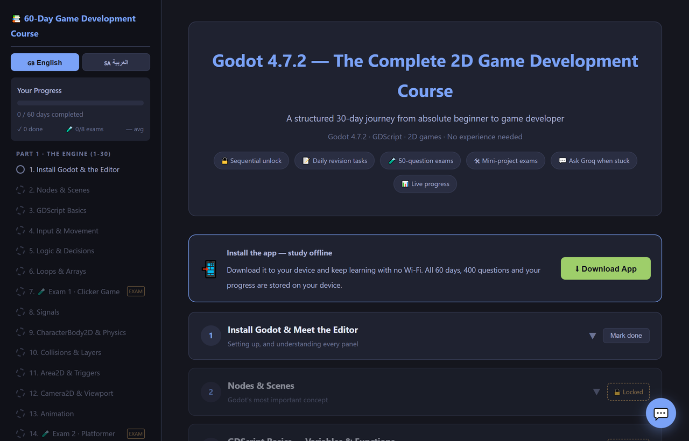
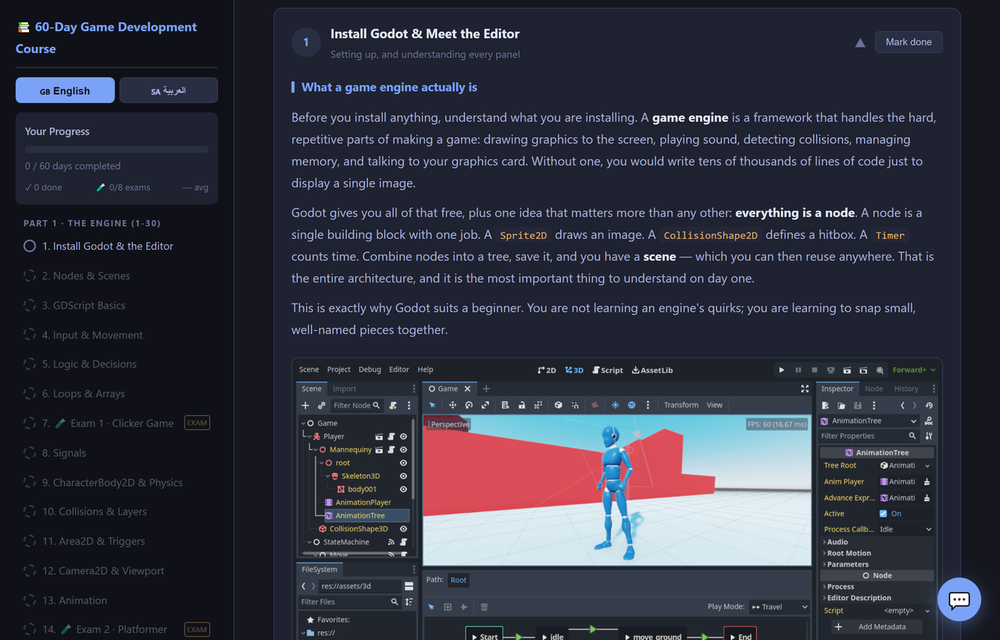
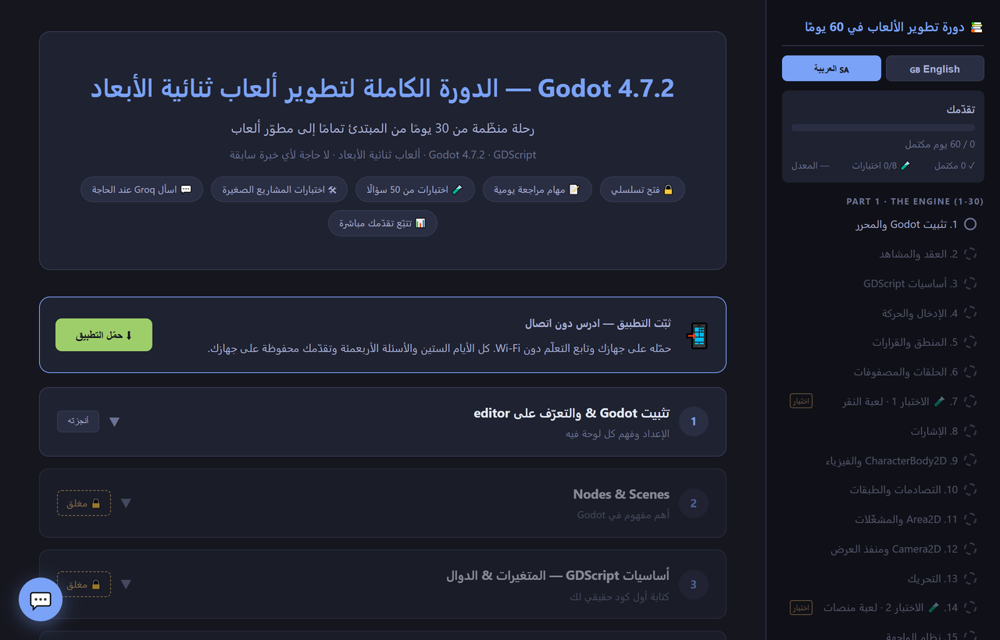
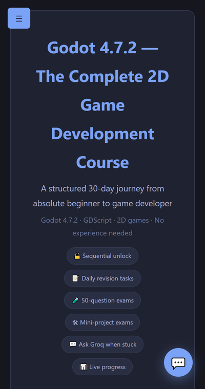
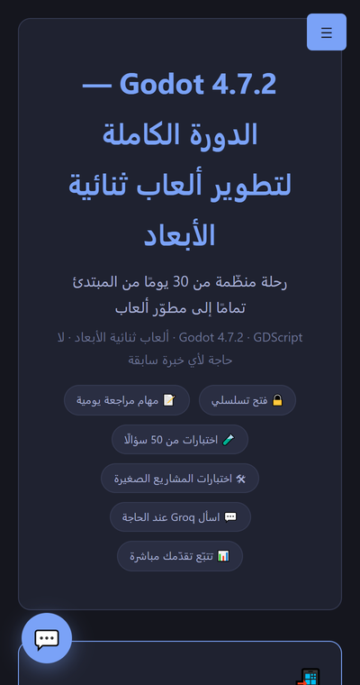

<div align="center">

# 🎮 Godot 4.7.2 — The Complete 60-Day Game Development Course

**Learn Godot and game development from zero — 60 days, 400 exam questions, in English and Arabic.**
**Works completely offline. No sign-up, no account, no server.**

### 👉 **[Start the course →](https://theflamingparrot.github.io/minigodotcourse/)**

[](https://theflamingparrot.github.io/minigodotcourse/)
[](https://theflamingparrot.github.io/minigodotcourse/)
[](https://theflamingparrot.github.io/minigodotcourse/)



</div>

---

## What this is

A complete, self-contained course website. **60 days** taking you from having never
opened a game engine to designing, building and shipping your own 2D games.

It is a **single static page**. No backend, no database, no build step to use it.
Everything — all 60 lessons, all 400 exam questions, both languages, and every
screenshot — lives inside one file. Install it as an app and it runs with **no
internet at all**.

> **Just want to learn?** Open **[the live site](https://theflamingparrot.github.io/minigodotcourse/)**
> and start Day 1. You do not need GitHub for anything else.

---

## The course

### Part 1 — The Engine (Days 1–30) · Godot 4.7.2

Install and editor · nodes and scenes · GDScript · input and movement · logic ·
loops and arrays · **Exam 1** · signals · CharacterBody2D physics · collisions and
layers · Area2D and triggers · Camera2D and viewports · animation · **Exam 2** ·
UI and Control nodes · HUD and autoloads · audio · TileMapLayer · scene management ·
particles · Tween · state machines · save and load · enemy AI · dialogue · menus ·
polish · **Exam 3** · design fundamentals · **Exam 4**

### Part 2 — Game Development (Days 31–60) · the craft, not the engine

| Days | Focus |
|---|---|
| **31–36** | **Design** — what a game is, the core loop, game feel and juice, player psychology, difficulty curves, level design without text, pacing |
| **37** | **Exam 5** — Design basics |
| **38–43** | **Mechanics** — coyote time, jump buffering, variable jump height, combat and telegraphs, NPCs, economy and progression, state machines, boss design |
| **44** | **Exam 6** — Mechanics |
| **45–50** | **Assets with no art skills** — why you don't need to draw, pixel art, vector art and free libraries, 3D-to-2D, procedural art, animation without animating |
| **51** | **Exam 7** — Assets |
| **52–59** | **Shipping and direction** — scoping a game you can finish, playtesting, iteration, case studies, designing a character you can't draw, maps, UI and onboarding |
| **60** | **🎓 Grand Final** — everything, across all sixty days |

Every teaching day ends with a **revision checklist of things to actually do**, a
written exercise, and key notes. It assumes **no art skill and no programming
background**.

<div align="center">

<br><em>Day 1, expanded — real screenshots from the official Godot docs, with the day's tasks below.</em>
</div>

---

## Features

- **📲 Installable app, works offline.** Press *Download App* and it installs like
  a normal app. After that, all 60 days, 400 questions and your progress work with
  **no Wi-Fi**. Useful for studying on a train, or on a phone with no data plan.
- **🌐 English and Arabic, with full RTL.** Switch in the sidebar. Godot and
  programming vocabulary (`Node`, `Scene`, `Inspector`, `GDScript`,
  `CharacterBody2D`, `TileMapLayer`, `Tween`, `Signal`, `enum`, `delta`…) stays in
  English inside the Arabic text — because the Godot editor itself is English and
  you have to recognise those words on screen. Game-design terms stay English too.
- **🔒 Sequential unlock.** Day 1 is open; finish a day and the next one unlocks.
  Locked days say which day to finish first. Exam days need **both** parts.
- **🧪 Eight two-part exams.** Part A is a 50-question test — 3 attempts, 70% to
  pass, then it locks. Part B is a mini-project, **locked until Part A passes**.
- **📊 Progress tracking.** Days done, exams passed, average score, and a per-exam
  breakdown. Finishing everything shows a completion banner.
- **💬 Ask Groq.** A built-in tutor. Get a question wrong and a button appears —
  *"Ask Groq why I got this wrong"* — which sends that question, your answer and
  the correct one. It refuses to help during exams. **Needs your own free Groq API
  key**; everything else works without it.

<div align="center">

<br><em>Same course, Arabic, full RTL layout.</em>
</div>

---

## Install it as an app

| Platform | How |
|---|---|
| **Android / Chrome** | Press **⬇ Download App** — or menu (⋮) → *Add to Home screen* |
| **iPhone / iPad** | Press **⬇ Download App** — or Share → *Add to Home Screen* |
| **Desktop** | Press **⬇ Download App**; it explains the address-bar install option, or just bookmark it |

<div align="center">

&nbsp;&nbsp;&nbsp;

</div>

> The install prompt and offline mode need **HTTPS** — GitHub Pages provides it
> free, so the live link works.

---

## Using the AI tutor (optional, one minute)

1. Get a free key at **[console.groq.com/keys](https://console.groq.com/keys)**.
2. In the course, click **⚙️ API Settings** in the sidebar.
3. Paste the key and press **Save Key**.

Your key is stored **only in your own browser** and is sent **only to Groq**. It is
never sent anywhere else and is not in this repository.

---

## For developers

This repo is also the source. `site/` is the course; `dist/` is generated.

```
Arcadia/
├── site/                     ← the course page — EDIT THIS
│   ├── index.html            60 days, 400 questions, Arabic + English, the tutor
│   ├── sw.js                 offline cache
│   ├── manifest.webmanifest  makes it installable
│   ├── icon-192.png, icon-512.png
│   └── _headers, robots.txt, sitemap.xml, 404.html
├── course_img/               the 24 Godot documentation screenshots
├── course/
│   ├── _content/             source copies of the text, Arabic, question banks
│   └── _build/
│       ├── _check.py         build dist/ and verify it
│       ├── _ui_test.js       browser UI test suite (167 checks)
│       └── _ui_report.md     what the UI tests found and fixed
├── docs/                     the screenshots in this README
└── dist/                     generated — never edit
```

### Build

```bash
python course/_build/_check.py
```

Wipes `dist/`, rebuilds it from `site/` + `course_img/`, then verifies: 60 days,
8 banks, 400 questions, Arabic present, images embedded and correctly typed, every
shipped asset resolves. Exits non-zero on any failure.

### UI tests

Real Chrome, seven viewports from 320px to 1440px, both languages, plus a
simulated installed-app context — checking overflow, overlap, off-screen elements,
the menu/sidebar/chat positions and language round trips.

```bash
COURSE_PAGE=/path/to/dist/index.html OUT_DIR=. node course/_build/_ui_test.js
```

Current status: **167/167 pass**. See [`_ui_report.md`](course/_build/_ui_report.md).

### Deploying

`.github/workflows/pages.yml` builds `dist/` and publishes it to GitHub Pages on
every push to `main`. **Do not publish `site/` directly** — the screenshots are
embedded into the page by the build, so an unbuilt copy has 20 broken images.

> ⚠️ **After editing the page, bump `CACHE_VERSION` in `site/sw.js`.** Otherwise
> anyone who already installed the app keeps getting the old page from their cache.

---

## Credits and honesty

- **Part 1** follows the official **[Godot 4.7.2 documentation](https://docs.godotengine.org/)**.
  The screenshots are the real images from the Godot docs repository, used for
  teaching purposes.
- Where the docs and reality disagree, the course follows reality and says so —
  e.g. `AudioStreamPlayer.area_mask` defaults to `0` in 4.7, which silently breaks
  reverb zones.
- **Part 2** is game-development craft: design, psychology, mechanics, making assets
  without drawing, and shipping.
- This course is an independent teaching resource and is **not affiliated with or
  endorsed by the Godot Foundation**.

---

## Licence

Course text and code: **MIT** — see [LICENSE](LICENSE). Use it, fork it, teach with
it, translate it.

The Godot documentation screenshots in `course_img/` remain the property of the
Godot project under their own licence. Details in
[THIRD-PARTY-NOTICES.md](THIRD-PARTY-NOTICES.md).

---

<div align="center">

**Found a mistake, or want a translation?** Open an
[issue](https://github.com/Theflamingparrot/minigodotcourse/issues) — that is what
it is there for.

*Good luck. Now go make something only you would make.* 🌸

</div>
